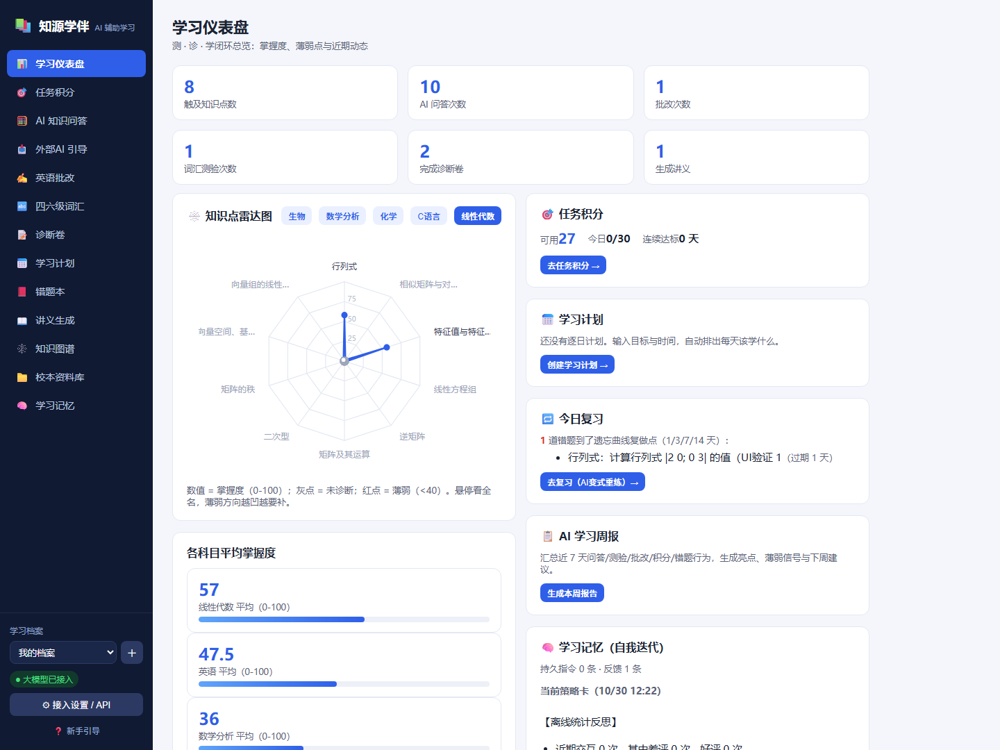
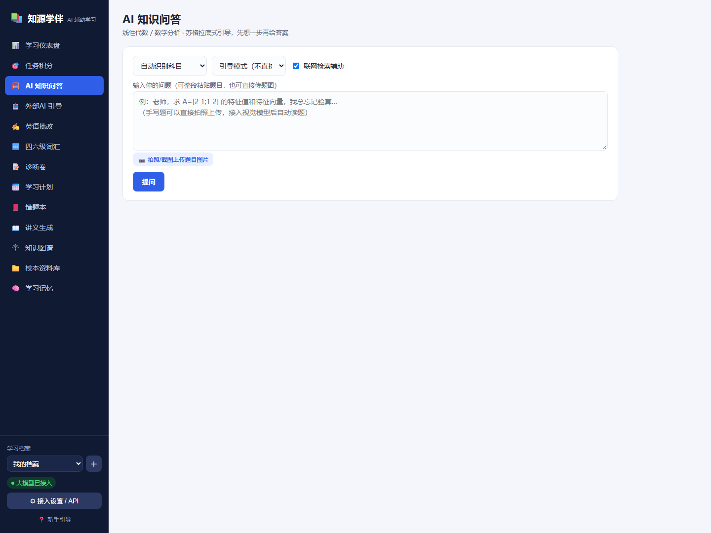
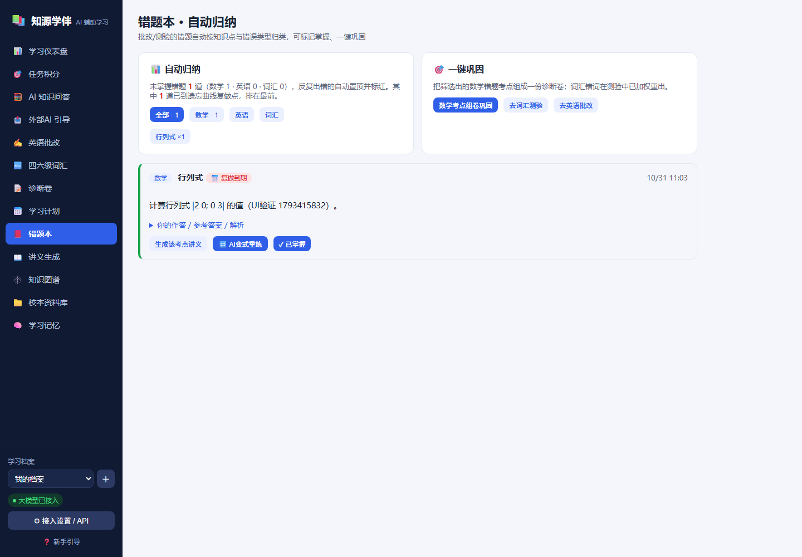
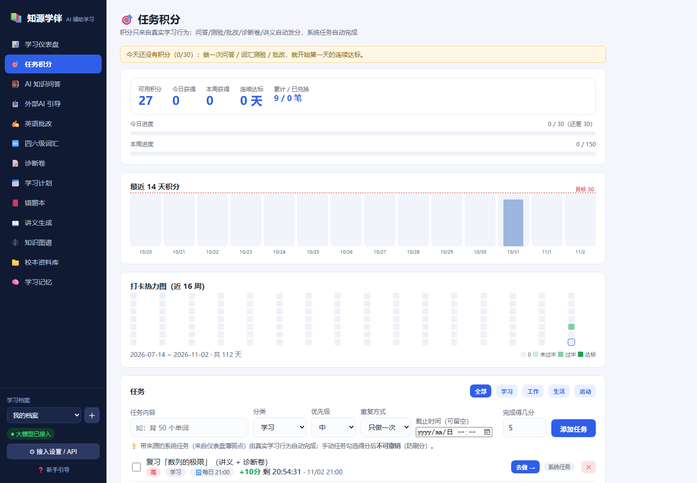
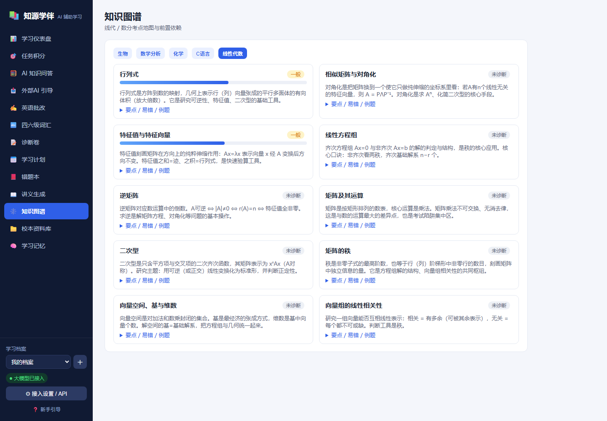

<div align="center">

# 知源学伴 · ZhiYuan Study

**面向大学生的 AI 学习伙伴**
引导式问答 · 错题变式重练 · 诊断卷 · 间隔复习 · 积分督学

[](https://www.python.org/)
[](#技术架构)
[](#部署方式)
[](#数据与隐私)
[](LICENSE)



</div>

---

## 🌐 在线体验（临时演示，可能离线）

**<https://choice-groom-emphasis.ngrok-free.dev>**

> ⚠️ 这是**作者本机的临时演示**，绑在一台个人电脑上：关机、休眠、或作者关掉隧道时就打不开，也可能随时停止。
> 仅用于看一眼界面，**不要依赖它**。想稳定使用请按下方「快速开始」自己跑一份（30 秒）。

| | |
|---|---|
| 账号 | 需**自己注册**（用户名 ≥2 字符，密码 ≥6 位），数据按账号隔离 |
| 首次访问 | 会先看到 ngrok 的提示页，点 **Visit Site** 进入 |
| 打不开怎么办 | 直接自己跑一份 → [本机版使用指南](docs/本机版使用指南.md) |

> 想让它 7×24 在线？见 [部署方式](#部署方式)：国内学生机 10–30 元/月，或任意 Ubuntu VPS 一条命令装完。

---

## 这是什么

一个**纯 Python 标准库**写的 AI 学习系统，零第三方依赖、无需前端构建，双击就能跑在自己电脑上。

它解决的不是"帮你写作业"，而是**让你真的学会**：

- **先引导后答案**：默认苏格拉底式反问，逼你先想一步；想看完整推导再切"讲解模式"
- **错题闭环**：错题自动归类 → AI 出同考点变式题 → 做对才允许标记掌握
- **测 · 诊 · 学 循环**：诊断卷找薄弱点 → 生成讲义 → 间隔复习（1/3/7/14 天）→ 再测
- **积分只来自真实学习行为**，账本只增不退，不能手动刷分

> 数据落在自己硬盘，AI 可用免费通道 —— 不绑卡、不买服务器也能用。

---

## 界面

<table>
<tr>
<td width="50%"><br><sub><b>AI 知识问答</b>：五科考点匹配、引导式反问、拍照读题、流式输出</sub></td>
<td width="50%"><br><sub><b>错题本</b>：按知识点/错因归类，AI 变式重练，连错置顶标红</sub></td>
</tr>
<tr>
<td width="50%"><br><sub><b>任务积分</b>：14 天趋势、16 周热力图、奖励兑换、只增不退</sub></td>
<td width="50%"><br><sub><b>知识图谱</b>：五科 47 考点、前置依赖、掌握度着色</sub></td>
</tr>
</table>

---

## 快速开始（30 秒）

```bat
git clone https://github.com/HZX-26378130/zhiyuan-study.git
cd zhiyuan-study
启动.bat
```

浏览器打开 **<http://127.0.0.1:8765>** —— 就这样，不需要 pip install、不需要 node。

- 只有 Python 3.8+ 是硬要求（安装时勾选 `Add python.exe to PATH`）
- 不配任何 Key 也能用：内置知识图谱 + 启发式批改 + 四六级真题库
- 📖 详细步骤见 **[本机版使用指南](docs/本机版使用指南.md)**

---

## AI 怎么接（四档，按需选）

| 档位 | 要不要 Key | 能力 | 适合 |
|---|---|---|---|
| **离线模式** | 不要 | 知识图谱匹配、规则批改、真题库、词汇测验 | 就想先跑起来看看 |
| **智谱 GLM**（推荐） | 要，**免费** | 完整 AI 讲解/批改/命题 + **免费视觉**（拍照读题） | 日常使用 |
| **本地 Ollama** | 不要 | 完整 AI，完全离线不联网 | 无网/隐私优先 |
| **免 Key 兜底** | 不要 | 能出真实 AI 回答，但**限 1 次/45 秒、不能读图** | 应急 |

界面里点侧栏 **「⚙ 接入设置 / API」** → 选预设 → 填 Key → 保存（Key 只存本机 `config.json`）。

> 主通道失败（欠费/限流/断网）会**自动降级**到下一条通道，失败通道熔断 180 秒；
> 兜底通道不继承你的主 Key，不会把 Key 发给第三方。

---

## 功能一览

| 模块 | 能做什么 |
|---|---|
| 🧮 **AI 知识问答** | 线代/数分/C语言/生物/化学；考点自动定位；引导式反问；拍照读题；联网检索辅助 |
| ✍️ **英语批改** | 四六级作文/翻译逐句改错 + 分维度点评 + 范文；含 2023.12–2025.6 共 14 套真题；手写作文可拍照 |
| 🔤 **四六级词汇** | CET-4 7508 / CET-6 5651 开源词库；错词加权重出；生词本自动积累 |
| 📝 **诊断卷** | 按薄弱点自动命题 → 交卷自动批改 → 错因回写画像 → 精讲报告（雷达图 + 逐题讲解） |
| 🏦 **题库 · 组卷工作台** | 本地化大学数学题库（线代/数分 42 题种子库，可自录扩充）：知识点定位、稳定题目 ID、难度梯度智能组卷、A4 仿真排版导出 PDF、一键转为可自动批改的作答卷；并提供只读 Agent 取题接口（`/api/bank/capabilities → search → item`） |
| 📕 **错题本** | 自动归纳 + AI 变式重练 + 掌握度门槛，反复出错置顶 |
| 🧮 **BKT 知识追踪** | 掌握度用贝叶斯知识追踪更新：答对时扣掉"蒙对"、答错时扣掉"手滑"，每次作答后叠加学习转移 |
| 🔁 **间隔复习** | 1/3/7/14 天遗忘曲线排期，到期进"今日复习"，连过 4 轮毕业 |
| 📅 **学习计划** | 输入目标/考试日期/每日时长 → 按前置依赖 + 薄弱点排出逐日课程 |
| 📖 **讲义 / 每日课程** | 四步法（概念 → 例题 → 填步 → 变式），可导出 .md / 打印 |
| 🎯 **任务积分** | 只由真实行为发分（问答+2 / 答对×2 / 批改+5 / 诊断卷+10 / 讲义+8） |
| 🧠 **自我迭代记忆** | 👍👎 反馈 + 持久指令 → 反思出"教学策略卡" → 反哺后续所有提示词 |
| 📁 **校本资料库** | .txt/.md/.docx/**pdf** 单文件或整文件夹批量导入（PDF 纯标准库解析，扫描件会提示需 OCR），问答自动引用【校本资料】 |
| 🕸️ **知识图谱** | 五科 47 个考点（线代10/数分11/C语言9/生物9/化学8），含例题与易错点 |
| 📊 **学习周报** | 聚合近 7 天行为，AI 生成亮点 / 薄弱信号 / 下周建议 |
| 🛠 **管理端** | 用户数、AI 调用量/成功率/耗时、反馈正负比、通道健康度、全班共性薄弱点、学员明细、长期复盘。**仅管理员本人可见**（`ZY_ADMIN_USER` 指定账号 / `ZY_ADMIN_TOKEN` 口令） |
| 💻 **桌面版 exe** | 一条命令打成 Windows 程序：双击运行、自动开浏览器、数据存 `%APPDATA%`、卸载不丢数据 |

---

## 两种用法：个人版 / 班级版

| | 💻 桌面版（exe） | 🌐 服务器版 |
|---|---|---|
| 谁用 | 每个人装一份 | 一个地址全班用 |
| 数据 | 各在自己电脑，互不可见 | 集中存储 |
| 管理端 | 看**自己这台机器**的数据 | 看**全班**数据 |
| 需要 | 双击 exe | 一台 7×24 的主机 |

```bat
:: 桌面版：构建一次，之后双击 exe
powershell -ExecutionPolicy Bypass -File packaging\build_exe.ps1
:: 产物 dist\知源学伴\知源学伴.exe（便携 zip 约 12 MB）
```

> 管理端与桌面版的完整说明（指标口径、鉴权、数据目录、误报处理）见
> **[docs/管理端与桌面版.md](docs/管理端与桌面版.md)**。

---

## 部署方式

| 方式 | 成本 | 是否要卡 | 数据 | 说明 |
|---|---|---|---|---|
| **本机运行** | 0 | 否 | 本机磁盘 | 双击 `启动.bat`，最简单 |
| **本机 + Cloudflare 隧道** | 0 | 否 | 本机磁盘 | 一条命令得到公网地址 → [tunnel.bat](deploy/windows/README.md) |
| **本机 + ngrok 固定域名** | 0 | 否 | 本机磁盘 | 有固定 `xxx.ngrok-free.dev`，带警告页/1GB 月流量 |
| **自建域名（Cloudflare）** | 域名 10–40 元/年 | 否 | 本机或服务器 | 固定 `https://study.你的域名` → [setup-domain.bat](deploy/windows/README.md) |
| **任意 Ubuntu VPS** | 10–30 元/月 | 否 | 服务器磁盘 | 一条命令装完 → [deploy/oracle/install.sh](deploy/oracle/README.md) |
| **免费容器平台** | 0 | 否 | ⚠️ 临时磁盘 | HF Spaces / Koyeb / Render；**必须开每日归档** → [deploy/archive](deploy/archive/README.md) |

> 公网暴露时**务必**设 `ZY_AUTH=1`（账号登录、数据按账号隔离）；否则任何拿到链接的人都能看到全部数据。

---

## 技术架构

```
zhiyuan-study/
├── server.py              # 入口：ThreadingHTTPServer（无框架）
├── backend/               # 纯标准库后端，21 个模块
│   ├── http_app.py        #   路由 + 静态服务 + multipart + SSE 流式
│   ├── llm.py             #   OpenAI 兼容客户端 + 多通道兜底 + 熔断 + 输出解析修复
│   ├── store.py           #   存储：本地 JSON / 可选 PostgreSQL REST
│   ├── auth.py            #   账号：PBKDF2-SHA256 + HMAC 令牌（自托管可用）
│   ├── archive.py         #   每日归档：快照 → GitHub / webhook
│   └── qa / english / vocab / paper / notes / plan / daily /
│       wrongbook / points / memory / weekly / materials / search / knowledge / external
├── frontend/              # 原生 HTML/CSS/JS 单页应用（无构建、无框架）
├── data/                  # 词库 / 47 考点图谱 / 真题库 / 运行时数据
├── deploy/                # oracle（VPS 一键）· windows（本地/隧道/备份）· archive（归档）
└── docs/                  # 本机版使用指南 · 界面截图
```

**几个刻意的取舍**

- **零依赖**：只用标准库，任何有 Python 的机器都能跑，不会因为依赖升级而坏
- **无构建**：前端原生 JS，改完刷新即生效，不用 node_modules
- **数据在磁盘**：JSON 文件即数据库，备份=复制文件夹，迁移=拷过去
- **可降级**：模型挂了自动走兜底/离线规则，页面不会白屏

---

## 数据与隐私

| 内容 | 位置 |
|---|---|
| 学习数据（档案/错题/积分/讲义/图片） | `data/db/` |
| AI 配置（含 Key） | `config.json` |
| 会话签名密钥 | `data/db/.secret`（首次自动生成） |

- `config.json`、`data/db/`、`.env` 均在 `.gitignore` 中，**不会被提交**
- 仓库里不含任何 API Key（自托管版本由部署者自己填）
- 备份：界面「⚙ 接入设置 → ⬇ 备份数据」导出 zip，或直接复制 `data/db`

---

## 测试

```bat
py -3 scripts\smoke_test.py      # 后端全链路（离线）
py -3 scripts\http_test.py       # HTTP 端到端
py -3 scripts\http_test_v2.py    # v2 端点
py -3 scripts\test_llm_json.py   # 模型输出解析回归（截断 / LaTeX 非法转义）
py -3 scripts\test_archive.py    # 每日归档回归（桩服务器模拟 GitHub API）
```

---

## 文档

- [本机版使用指南](docs/本机版使用指南.md) —— 安装、启动、AI 配置、备份、更新、常见问题
- [管理端与桌面版](docs/管理端与桌面版.md) —— 指标口径、管理员口令、exe 构建与数据目录
- [Linux VM 部署](deploy/oracle/README.md) —— Oracle 永久免费 / 任意 Ubuntu，含 systemd 与 Caddy HTTPS
- [Windows 工具集](deploy/windows/README.md) —— 上传部署、数据备份、隧道发布、固定域名
- [每日自动归档](deploy/archive/README.md) —— 免费容器平台的数据保险
- [更新日志](CHANGELOG.md) —— 各版本改了什么、升级会不会丢数据

---

## 设计上与常见产品不同

| 常见痛点 | 本项目做法 |
|---|---|
| 直接给答案，助长抄作业 | 默认引导模式还会反问学生；讲解模式手动切 |
| 题库泛化、与本校脱节 | 校本资料库优先（支持文件夹批量导入），高校开源资料索引兜底 |
| 答案来源不明 | 知网/百度学术/智慧教育平台/MOOC/MIT OCW 直达 + 联网检索 + 校本引用 |
| 作文只给分不给改法 | 逐句改错 + 错因 + 分维度点评 + 范文 |
| 一次问答，没有积累 | 测→诊→学→再测闭环 + 自我迭代记忆 |
| 数据在别人云端 | 全部本机文件，Key 只存本机 |

---

## 路线图

- [x] 界面内 API 接入 / 免 Key 联网搜索 / 拍照读题 / 近三年真题 / 精讲报告
- [x] KaTeX 公式渲染、多通道兜底与熔断、自托管账号体系、每日自动归档
- [x] **PDF 课件解析** — 纯标准库提取文本层，含 ToUnicode 中文还原；扫描件会明确提示需 OCR
- [x] **掌握度升级为 BKT 知识追踪** — 贝叶斯更新，"蒙对"与"手滑"都折算，不再是简单加减分
- [x] **前端可视化编辑兜底通道链** — 增删通道、每条独立 Key、全部删掉即关闭兜底
- [x] **视觉能力兜底** — 主通道没有视觉时，自动改用兜底链里配了 `vision_model` 的通道
- [ ] OCR 兜底（扫描版 PDF / 纯图片题）
- [ ] 深度学习知识追踪（DKT，需训练，暂不引入依赖）

---

## 参考与致谢

- [KyleBing/english-vocabulary](https://github.com/KyleBing/english-vocabulary) — 四六级词库
- [mathsdream/THU-math-source](https://github.com/mathsdream/THU-math-source)、[zawnpn/nku-sms-exams](https://github.com/zawnpn/nku-sms-exams)、[cbhua/mathmatics-note](https://github.com/cbhua/mathmatics-note) — 已收录进资料索引
- [ECNU-ICALK/EduChat](https://github.com/ECNU-ICALK/EduChat)、[Zenglian990/AI_Tutor_Release](https://github.com/Zenglian990/AI_Tutor_Release) — 教育大模型 / RAG 私教思路参考
- [yoli-mi/good-learning-skill](https://github.com/yoli-mi/good-learning-skill)、[Miaotofu01/Study-Mate](https://github.com/Miaotofu01/Study-Mate) — 四步法 / 学习路线理念参考
- [JudgePeach/math-question-bank](https://github.com/JudgePeach/math-question-bank) — 题库组卷工作台的设计参考：稳定题目 ID、知识点主辅标注、候选/完整两级读取与**只读 Agent 取题接口**（本项目 `bank/capabilities → search → item` 接口即借鉴其思路做成的大学版）

> 词库版权归原开源项目（MIT）；真题题面来自公开回忆版，仅用于学习；知识图谱、例题、范文为本项目自建。

---

## 许可证

本项目以 **MIT License** 发布 —— 可自由使用、修改、分发、商用，保留版权声明即可（见 [LICENSE](LICENSE)）。

第三方内容（词库、真题题面、资料索引的来源与许可）见 **[NOTICE](NOTICE)**：

| 内容 | 来源 | 许可 |
|---|---|---|
| `data/vocab/cet4.json`、`cet6.json` | [KyleBing/english-vocabulary](https://github.com/KyleBing/english-vocabulary) | MIT |
| 四六级真题题面 | 公开回忆版，仅用于学习 | 版权归原出题机构 |
| 知识图谱 / 例题 / 范文 / 讲义 | 本项目自建 | MIT |
